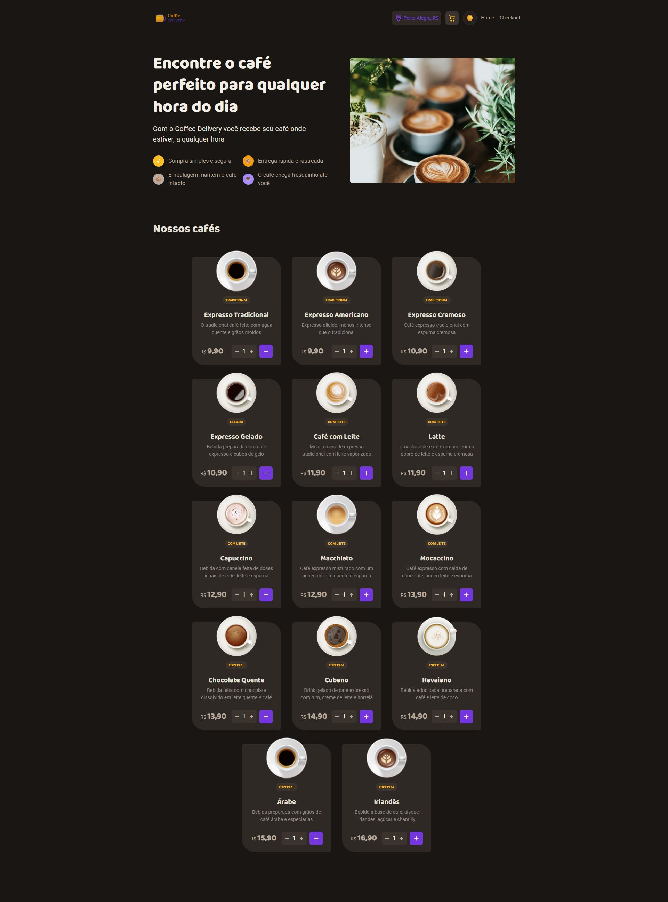
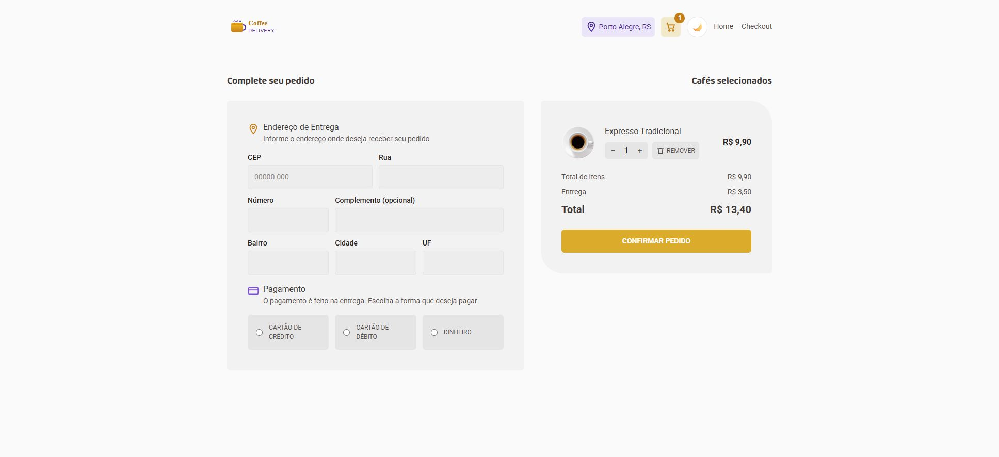

# Coffee Delivery

Aplicação de e-commerce de cafeteria (catálogo, carrinho, checkout e confirmação de pedido) desenvolvida como projeto final da disciplina **Single Page Application (SPA)**.

## Stack

- React + Vite + TypeScript
- React Router (`/`, `/checkout`, `/success`)
- Context API + useReducer (carrinho)
- React Hook Form + Zod (formulário e validação)
- Tailwind CSS (estilização) — escolhido por produtividade e consistência de tokens; registrado no `TECH_SPEC.md`
- localStorage (carrinho e tema)

## Instalação

```bash
npm install
npm run dev
```

## Scripts

- `npm run dev` — servidor de desenvolvimento
- `npm run build` — build de produção
- `npm run preview` — preview do build
- `npm run lint` — lint

## Estrutura

Ver `docs/TECH_SPEC.md` (seção 3).

## Documentação

- `docs/PRD_SPEC.md` — requisitos de produto (RF-01..RF-16, RN-01..RN-10)
- `docs/TECH_SPEC.md` — especificação técnica
- `docs/TASK_SPEC.md` / `docs/TASKS_SPEC.md` — plano de tarefas
- `AGENTS.md` — diretrizes para o assistente de IA

## Figma

Referência: arquivo "Coffee Delivery | Projeto Final React" (Home frame 2:1550, Checkout 217:511, Confirmação 222:824). Identidade de referência: amarelo e roxo, tipografias Baloo 2 e Roboto.

## Branding com IA

- **Ferramenta utilizada:** geração de imagem por IA (tentativa via assistente; credenciais de imagem indisponíveis neste ambiente).
- **Prompt utilizado:**
  > "A modern, minimalist logo for a coffee delivery brand named 'Coffee Delivery'. Flat design, a stylized coffee cup with steam and a subtle delivery/motion swoosh, warm yellow (#c47f17) and purple (#4b2995) color palette on a clean white background, vector-like, suitable for web header and favicon, no photorealism, crisp edges, centered composition, brand name 'Coffee Delivery' in a friendly rounded sans-serif font below the icon."
- **Resultado:** logo entregue como `src/assets/logo.svg` e favicon `public/favicon.svg`, seguindo o conceito do prompt (xícara de café + tipografia Baloo 2/Roboto, paleta amarelo + roxo), legível em dimensões reduzidas.
- **Motivos da escolha:** paleta quente (café) contrastando com roxo (entrega/movimento); tipografia amigável e legível em tamanhos pequenos; formato SVG escalável e sem imagens quebradas.

## Screenshots

| Home (Light) | Home (Dark) |
|---|---|
|  |  |

| Checkout | Sucesso |
|---|---|
|  |  |

## Tema e responsividade

- Light/dark mode com toggle no Header, persistido em `localStorage`, fallback `prefers-color-scheme`.
- Mobile-first; testado em 320/375/390/768/1280/1440 px.

## Uso de IA (evidências)

1. Elaboração/revisão dos documentos SPEC (`docs/PRD_SPEC.md`, `docs/TECH_SPEC.md`, `docs/TASK_SPEC.md`) e `AGENTS.md`.
2. Sugestão de arquitetura (Context API + useReducer, Hooks, Zod) e componentes.
3. Geração do conceito de logo e paleta (prompt documentado acima).
4. Revisão/depuração de código (ex.: validação de CEP, persistência).

## Deploy

Publicar em Vercel ou Netlify (build: `npm run build`, output `dist/`).
